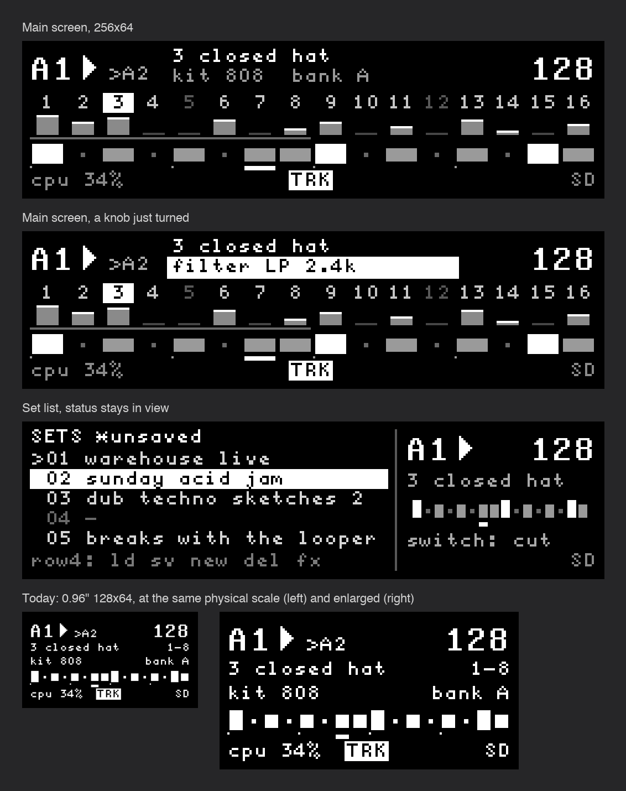
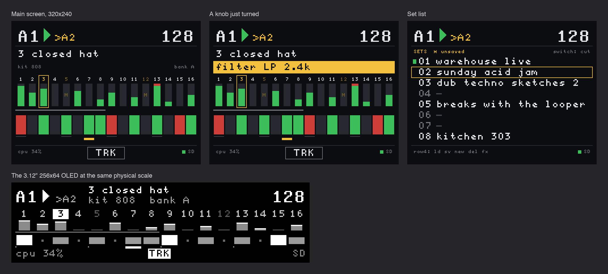

# A screen for the bare Daisy: options and mockups

Notes from 2026-11-27. Nothing here is built and none of the modules has been
on the rig. Sizes, controllers and module dimensions are from memory of common
parts: trust a listing's drawing over these numbers.

## Where it stands

The bare Daisy (APC40 on its USB host port, no companion box) has a 0.96"
SSD1306, 128x64, on I2C1 (`daisy/main.cpp`, class `Oled`). `daisy/box.cpp`
draws a fixed 128x64 one-bit image. The part was what was easy to get, not a
choice. On both Seeds wired so far it is the only display, read at arm's
length next to the APC40, often in the dark.

Decided so far: the small screen stays the only display on the bare Daisy.
Not decided: which screen. A selection of modules is to be ordered and looked
at on the desk.

## Candidates

Same 128x64 image on bigger glass (the drawing code stays):

| Size | Controller | What changes |
|---|---|---|
| 0.96" | SSD1306 | today |
| 1.3" | SH1106 | 132-column memory: a 2-pixel column offset, a different charge pump command |
| 1.54" | SSD1309 | usually a reset pin; many boards are SPI with I2C by solder jumper |
| 2.42" | SSD1309 | as 1.54", draws more current |

More pixels (the layout changes):

| Size | Resolution | Controller | Note |
|---|---|---|---|
| 2.08" | 256x64, 16 greys | SH1122 | glass about 51 x 13 mm |
| 3.12" | 256x64, 16 greys | SSD1322 | glass about 77 x 19 mm; SPI; 8 KB a frame; often ships set to 8-bit parallel |
| 1.5" | 128x128 | SH1107 / SSD1327 | twice the rows on small glass |
| 1.47" | 320x172 colour IPS | ST7789 | glass about 33 x 18 mm |
| 1.9" | 320x170 colour IPS | ST7789 | glass about 43 x 23 mm, module about 28 mm across |
| 2.4" | 320x240 colour | ST7789 | glass about 49 x 37 mm; sold on a board with an EC11 encoder and a button |

## The 3.12" 256x64 grey OLED



Drawn pixel for pixel with the box's fonts (`daisy/oledfont.h`). The sample
data is invented. Today's 0.96" is at the same physical scale, bottom left.

- All 16 tracks in one row: number, level, muted ones dim, the selected one
  inverted. The thin line under 1 to 8 is the page the APC40 has under its
  faders.
- Steps twice as wide; an accent is full brightness and taller, a plain step
  mid grey.
- A turned knob takes the kit line only.
- The set list has five rows and names up to 23 characters, with pattern,
  transport, tempo and steps still in view beside it.

What it costs: a new `Oled` class for SPI and 4-bit pixels; the frame buffer,
`Px`, `Text` and both `Compose...` functions in `box.cpp`; the image also goes
out as report lines, so a report version bump, `protocol/serial.md`,
`daisy/ui/apcbox-ui.html` and the bridge parser in one commit. With no colour
screen on the Seed, SPI1 (D7 to D10, D13, D14) is free for it.

Not checked: what drawing 16 level bars costs in the main loop; the panel's
grey steps need a gamma table before they look like the image; current at full
brightness against the Seed's 3V3 pin; burn-in from a layout that never moves.

## The 2.4" 320x240 colour board



Same fonts, the palette of `daisy/tftui.h`, colours as `docs/CANON.md`
section 6 says (a muted track is amber here; the 3.5" pages draw it red
today). The OLED mockup is underneath at the same physical scale.

- One board carries the screen, the encoder with its push and a second button:
  the bare Daisy's controls as they are now (D18, D19, D15, D20).
- ST7789 takes the same commands as the 3.5" screen's ST7796 on plain SPI.
  `daisy/tft.h` has the 8-bit command mode and the banded DMA send already.
- No touch chip: the firmware finds the colour screen by its touch chip
  answering on D9, so that check has to change.
- Its pull-ups go to VCC: power the board from 3.3 V.
- Single-size text (6x9) is about 1.4 mm tall on this glass, against about
  2.7 mm on the 3.12" OLED. A real layout needs everything at double size:
  26 characters a row.
- Eight rows in the set list against five.
- 320x240 is not a whole-number scale of the 480x320 pages: a fifth layout in
  `docs/CANON.md`, driven by the encoder.

Open until one is on the desk: whether the panel is IPS, and how it reads at
an angle and in the dark.

## How they compare

| | 2.4" colour board | 3.12" grey OLED |
|---|---|---|
| Firmware work | small: adapt a driver, a new layout | larger: new driver, grey drawing, report line |
| Wiring | one board | screen, encoder, button |
| In the dark | backlight glow | true black |
| Main screen | uses its height to make things tall | the same content in a third of the height |
| Lists | 8 rows of 26 | 5 rows of 42 |

## To order, one of each

| Screen | Controller | For | Check on the listing |
|---|---|---|---|
| 2.08" 256x64 grey OLED | SH1122 | the speaker's end wall (below) | module size against 67 x 26 mm; SPI |
| 3.12" 256x64 grey OLED | SSD1322 | a desktop Daisy | set to 4-wire SPI; 3.3 V |
| 2.42" 128x64 OLED | SSD1309 | today's image, 2.5 times bigger | I2C or SPI; reset pin |
| 1.3" 128x64 OLED | SH1106 | the smallest step up | I2C |
| 1.47" 320x172 IPS | ST7789 | colour for the end wall | IPS; CS pin broken out |
| 2.4" 320x240 with encoder | ST7789 | the front panel in one part | IPS if offered |

The two 256x64 panels share a layout but not a driver. Buy them in the same
colour so the comparison is about size.

## Tangent: the Bluetooth speaker as a case

A small Bluetooth speaker (board `winnershine FF008 BK V1.1`, one driver and a
passive radiator, a 3.7 V 800 mAh cell dated 2018, three buttons, a mic,
USB charging, line in) as a battery-powered case for a Seed with its own
monitor speaker. All of this is read off photos; nothing is measured with a
meter or built.

Plan: bypass, do not flash. The Bluetooth chip is an unknown part under glue.

- Keep: USB socket and charger, the cell, the amp chip, the driver and the
  passive radiator (it is what gives the box its bass, so it stays, and the
  box has to stay airtight: every new opening gets sealed).
- New: a switch and a 5 V boost from the cell to the Seed's VIN (the Seed
  wants at least 4 V); both Daisy outputs through a resistor each into one
  point and a divider, into the amp's input capacitor with its Bluetooth side
  lifted.
- The amp's shutdown pin was driven by the Bluetooth chip: tie it on, or wire
  it to a Daisy pin to mute at power-up.
- The power button is probably a soft button read by the Bluetooth chip: with
  that chip cut off, a real switch or a latch is needed.
- The three buttons may share one pin through a resistor ladder: one Daisy
  ADC pin would read them. A scroll wheel from a mouse is a quadrature encoder
  on most mice and works with the encoder code as it is.
- The mic needs a bias resistor and a preamp before the Daisy's input.
- Run time on that cell: an hour or two at a guess. Measure the Seed's draw
  first.
- Option for later: leave the Bluetooth chip powered and feed its audio into
  the Daisy's input, for the looper and live sampling from a phone.

Measurements from the photos, give or take 2 mm: case about 95 mm long
outside and 90 inside; end wall about 67 mm inside; wall height about 30 mm
floor to rim, about 26 usable under the lid's ledge. The board's button leg
runs from about 7 to 65 mm along the button side.

Where things go, as far as it got: the strap holder on one end wall comes
out; the screen sits in that wall facing out with the Seed flat behind it,
wires soldered to its pads, no pin headers. Its USB socket then points at a
long side wall. The 2.08" 256x64 OLED or the 1.47" colour panel fit that
wall; the 1.9" does not.

To do before choosing: measure the strap pocket from outside (length across
both slots, height, distance from its top edge to the rim); a sharp photo of
the amp chip's marking for its pinout; check that nothing from the USB socket
or `B+` runs down the button leg before cutting it.

## Redrawing the mockups

```
python3 tools/mock_oled.py daisy/oledfont.h docs/images/mock-oled-256x64.png
python3 tools/mock_tft.py daisy/oledfont.h docs/images/mock-oled-256x64.png docs/images/mock-tft-320x240.png
```

Both need Pillow. The second pastes the first's main screen in for the size
comparison, so run them in that order.
